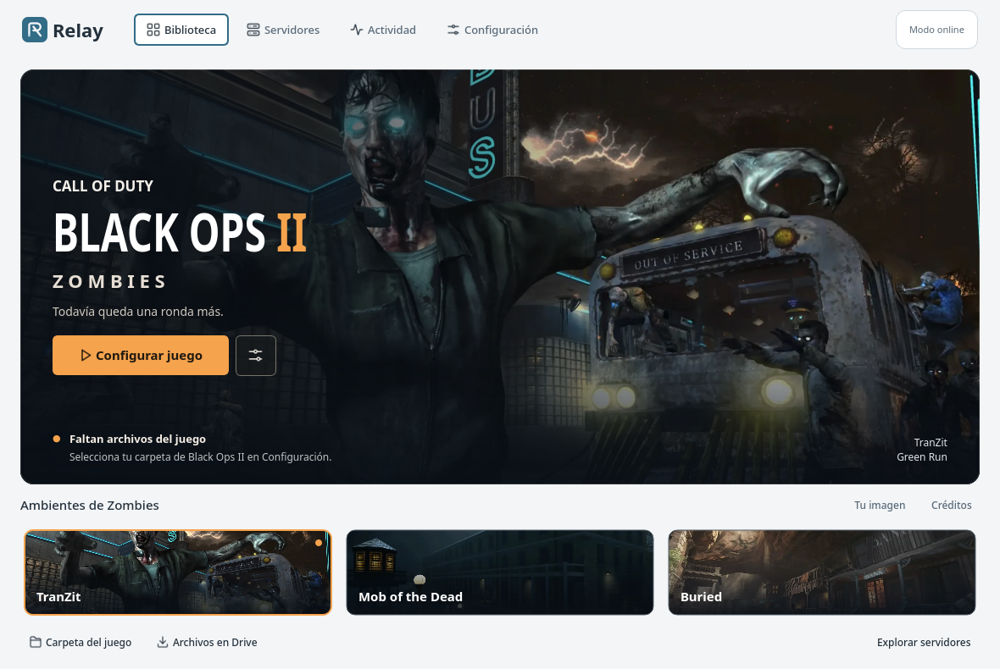

<p align="center"></p>
<h1 align="center">Relay</h1>
<p align="center">Tu próxima ronda empieza aquí.<br>Un launcher para <strong>BO2 Zombies + Plutonium</strong> en Linux y Windows.</p>

<picture>
  <source media="(prefers-color-scheme: dark)" srcset="docs/relay-dark.png">
  
</picture>

### Clona y ejecuta

Necesitas **Git y Python 3.12+**. El primer inicio instala las dependencias.

**Linux x64**

```bash
git clone https://github.com/centeno2/relay-launcher.git
cd relay-launcher
./iniciar.sh
```

**Windows 10/11 x64** · PowerShell o CMD

```powershell
git clone https://github.com/centeno2/relay-launcher.git
cd relay-launcher
.\iniciar.cmd
```

### Prepara tu primera ronda

1. **[Abre la carpeta del juego en Drive](https://drive.google.com/drive/folders/18CGqf5rwuULAL8-2XiH8-4UcGoKRUyNa?usp=sharing)**, descarga y extrae los archivos.
2. En Relay, elige **Carpeta del juego**. En **Configuración**, pulsa **Instalar componentes** y después **Actualizar componentes**.
3. Abre **Cuenta de Plutonium → Abrir sesión oficial**, inicia sesión y cierra esa ventana. Vuelve a **Jugar Zombies**.

**A tu manera:** fotos reales de TranZit, Mob of the Dead y Buried, galería con perspectiva 3D, fondo con profundidad y temas sistema/claro/oscuro. Todo el arte funciona sin conexión; el movimiento se puede desactivar.
Linux usa Wine + DXVK en un entorno separado. Windows ejecuta Plutonium directamente.

En Linux puedes añadir Relay al menú de aplicaciones con `./instalar.sh`.
Requisitos y ayuda: **[guía breve](docs/USO.md)**. Desarrollo y ramas: **[contribuir](CONTRIBUTING.md)**.

[Créditos de las imágenes](docs/ARTWORK.md).

<sub>Proyecto comunitario independiente. El repositorio contiene el launcher; el juego y Plutonium conservan sus respectivos autores. Windows tiene soporte nativo implementado; la ejecución del juego en un equipo Windows está pendiente de validación.</sub>
